<div align="center">

# Oddlings

**Procedural C++20 creature simulation for M5Stack CoreS3 and Tab5**

[](#firmware-downloads)
[](#cores3-320240)
[](#tab5-sanctuary-hub-1280720)
[](#esp-now-wireless-sync)
[](#firmware-downloads)

<br />

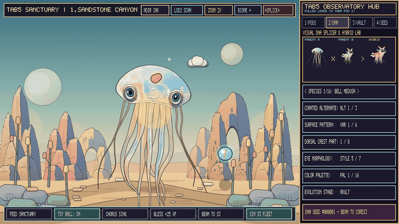

</div>

---

## Overview

Oddlings is a real-time C++20 creature simulation and software rasterizer for the **M5Stack CoreS3** (`320×240`, ESP32-S3) and **M5Stack Tab5** (`1280×720`, ESP32-P4).

Creatures are generated procedurally in C++ from a 64-bit seed (`uint64_t`) with no sprite sheets. Body geometry, spline tentacles, articulated limbs, watercolor shading, and pen-and-ink crosshatching are computed per scanline.

---

## Firmware Downloads

Download prebuilt `.bin` images directly below or from the [Releases](https://github.com/ericliberda7/oddlings/releases) page:

| Target Device | Binary File | Type & Flash Offset | Direct Download |
| :--- | :--- | :--- | :---: |
| **M5Stack CoreS3** (`ESP32-S3`) | `Oddlings.bin` | M5Launcher / MicroSD / OTA App (`0x10000`) | [**Download `Oddlings.bin`**](https://github.com/ericliberda7/oddlings/raw/main/sdcard/Oddlings.bin) |
| **M5Stack CoreS3** (`ESP32-S3`) | `Oddlings_Full_Merged.bin` | Full Merged Factory Image w/ Bootloader (`0x0000`) | [**Download `Oddlings_Full_Merged.bin`**](https://github.com/ericliberda7/oddlings/raw/main/sdcard/Oddlings_Full_Merged.bin) |
| **M5Stack Tab5 Hub** (`ESP32-P4`) | `Oddlings_Tab5_Hub.bin` | M5Launcher / MicroSD / OTA App (`0x10000`) | [**Download `Oddlings_Tab5_Hub.bin`**](https://github.com/ericliberda7/oddlings/raw/main/sdcard/Oddlings_Tab5_Hub.bin) |
| **M5Stack Tab5 Hub** (`ESP32-P4`) | `Oddlings_Tab5_Hub_Full_Merged.bin` | Full Merged Factory Image w/ Bootloader (`0x0000`) | [**Download `Oddlings_Tab5_Hub_Full_Merged.bin`**](https://github.com/ericliberda7/oddlings/raw/main/sdcard/Oddlings_Tab5_Hub_Full_Merged.bin) |

### Flashing Instructions

- **M5Launcher / MicroSD:** Copy [`Oddlings.bin`](https://github.com/ericliberda7/oddlings/raw/main/sdcard/Oddlings.bin) (CoreS3) or [`Oddlings_Tab5_Hub.bin`](https://github.com/ericliberda7/oddlings/raw/main/sdcard/Oddlings_Tab5_Hub.bin) (Tab5) to the root of a FAT32 MicroSD card and select it in M5Launcher.
- **esptool.py (Full Factory Image at `0x0000`):**
  ```bash
  esptool.py --chip esp32s3 write_flash 0x0000 Oddlings_Full_Merged.bin
  ```

---

## CoreS3 (`320×240`)

| **Noir Pen-and-Ink Mode** | **Touch & 1.9× Zoom** | **Feeding & Ball Physics** |
| :---: | :---: | :---: |
| 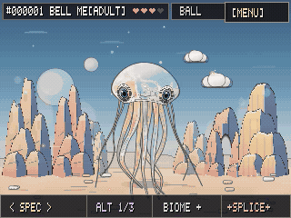 | 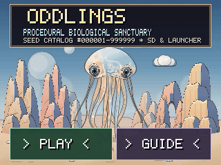 | 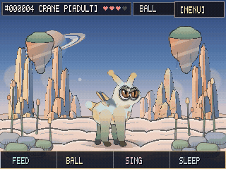 |
| <sub>Toggle `NOIR: ON` for red-filter luminance separation and 45°/135° crosshatching.</sub> | <sub>Touch tracking, tentacle brushing, and double-tap 1.9× close-up zoom.</sub> | <sub>Drop food spores or spawn an elastic ball that reacts to screen tilt.</sub> |
| **IMU Tilt & Flip** | **16 Species & Hybrid Breeding** | **4-Stage Growth** |
| 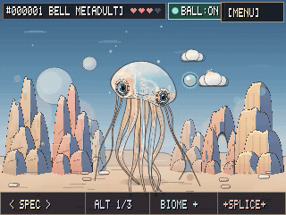 | 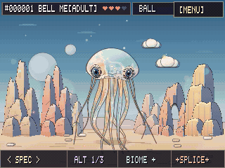 | 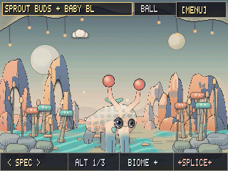 |
| <sub>BMI270 6-axis gyro and accelerometer drive zero-G float and dizzy rolls.</sub> | <sub>16 base species (3 variants each) plus seed-based hybrid splicing.</sub> | <sub>Creatures progress from `BABY` → `JUVENILE` → `ADULT` → `ELDER*`.</sub> |
| **Voice Synth & Sleep** | **DNA Sculptor & Seed Keypad** | **ESP-NOW & On-Device OS (`5:UPD`)** |
| 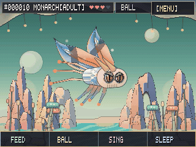 | 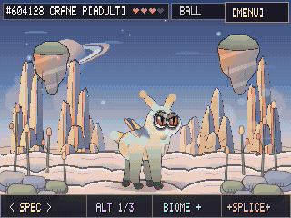 | 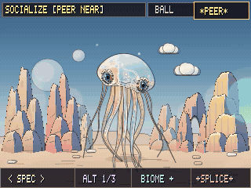 |
| <sub>4-voice formant audio responses, mic input, and sleep mode.</sub> | <sub>Edit dorsal parts, eye styles, and palettes, or load any 6-digit seed.</sub> | <sub>5-tab on-device menu (`1:PET`, `2:FAV`, `3:CFG`, `4:DNA`, `5:UPD`) and OTA tools.</sub> |

<p align="center">
  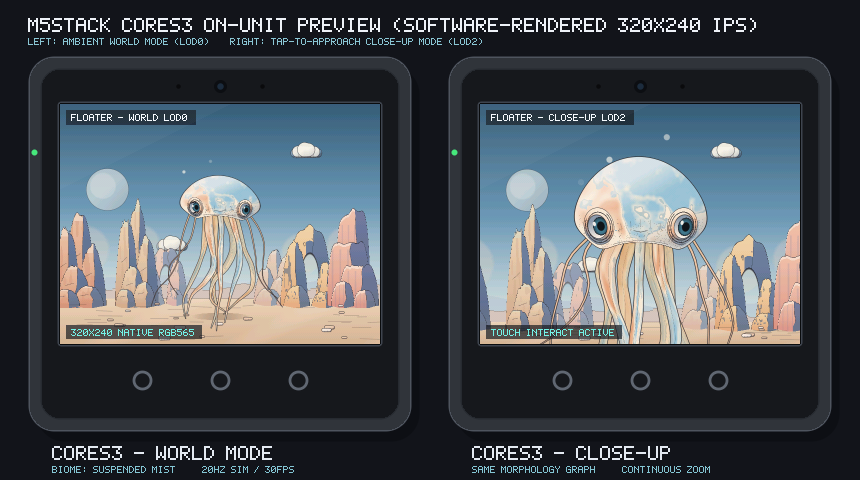
</p>

---

## Noir Mode (Pen-and-Ink Crosshatching)

Toggling **`NOIR: ON`** in the `1:PET` or `3:CFG` menu switches the DMA scanline output to a monochrome pen-and-ink pass:

- **Panchromatic Red Filter:** Boosts warm creature tones against darker sky gradients (`warm_boost = ((r - b) * 3) >> 3`).
- **3-Tier Crosshatching:** Applies `45°` hatching in midtones, `135°` crosshatching in shadows, and horizontal engraving ticks in deep recesses with contour darkening.

<p align="center">
  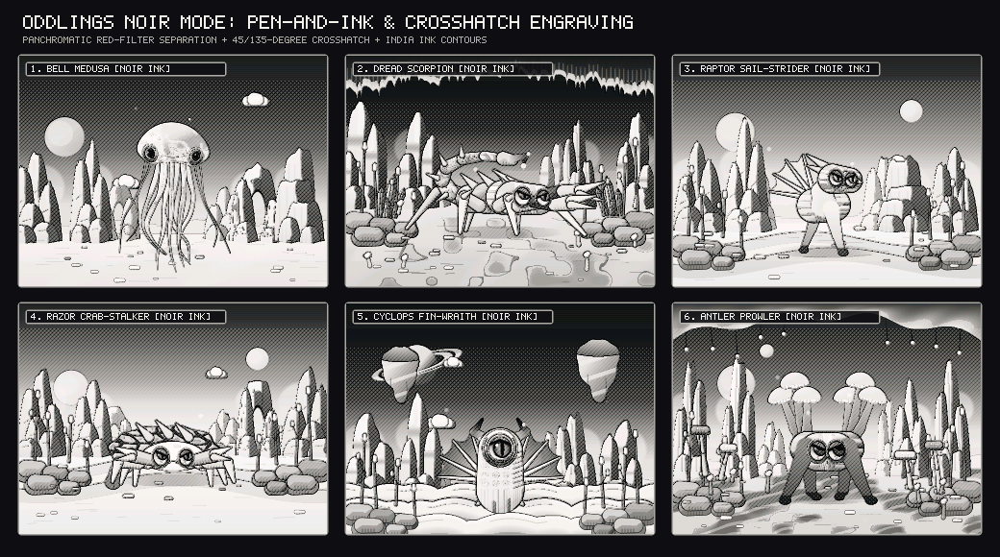
</p>

---

## Tab5 Sanctuary Hub (`1280×720`)

The Tab5 build pairs a **960×720 Sanctuary viewport** (3.0× render scale) with a **320×720 Command Deck**:

- **`1:PODS`:** Manage sanctuary pods and view nearby CoreS3 units over ESP-NOW.
- **`2:DNA`:** Live parent-to-offspring hybrid preview and trait controls.
- **`3:VAULT` & `4:SEED`:** 16-slot persistent seed bank, wireless OTA check, and 6-digit seed keypad.

<p align="center">
  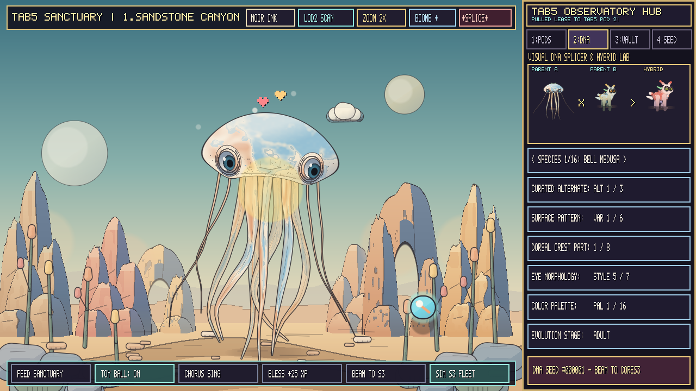
</p>

---

## All 16 Species & 4-Stage Growth

Each of the 16 primary species includes 3 curated alternates (48 base morphs) across 16 procedural biomes, plus arbitrary hybrid combinations via 6-digit seeds (`#000001`–`#999999`).

<p align="center">
  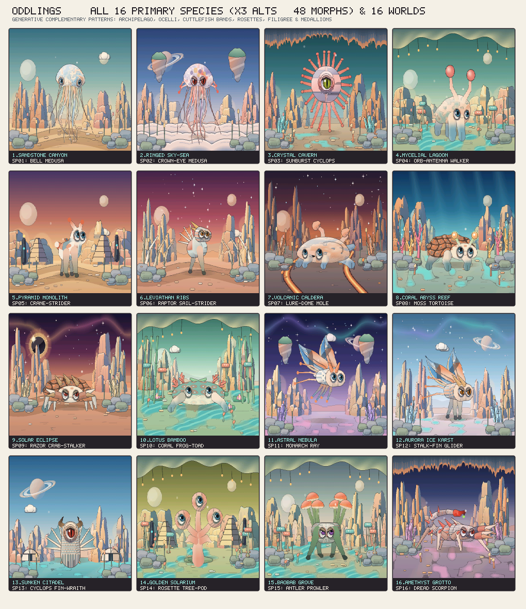
</p>

<p align="center">
  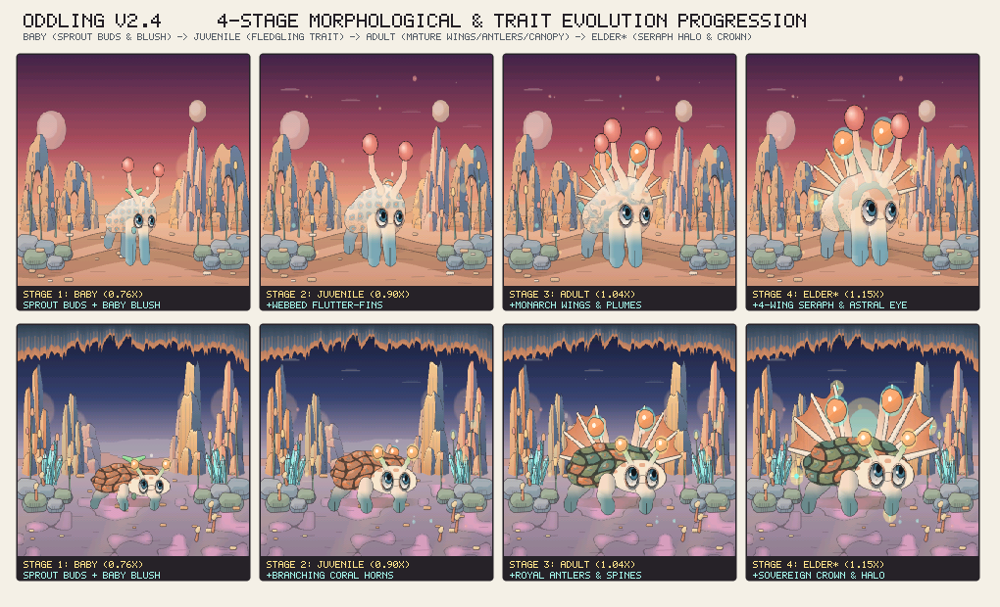
</p>

<p align="center">
  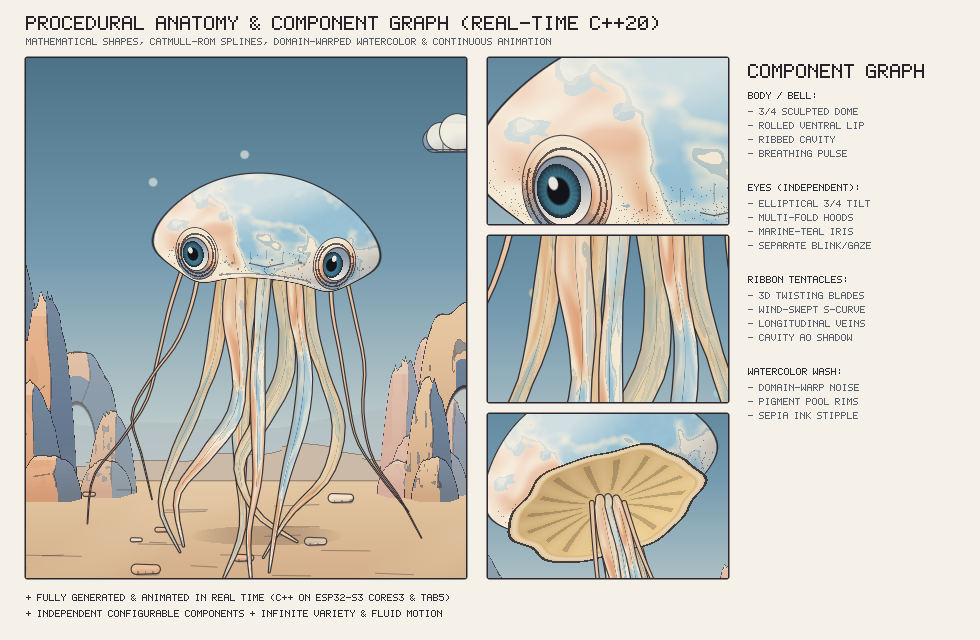
</p>

---

## Firmware OTA Updates & M5Launcher

The on-device **`5:UPD`** tab includes built-in wireless HTTPS OTA and MicroSD update tools so you can update or switch firmwares directly on the device:

- **Wireless HTTPS OTA & MicroSD Update (`[INSTALL OS]` / `[CHECK FOR OS UPDATES]`):** Connects via 2.4 GHz Wi-Fi (`[WIFI CFG]` or `/wifi.txt` on MicroSD) or scans MicroSD (`/oddlings_update.bin`, `/update/Oddlings.bin`, `/oddlings/update.bin`), verifies the `0xE9` ESP32 image header, backs up all saved state to NVS and `/oddlings/save_v26.dat`, and flashes the new image directly to the OTA partition with an on-screen progress bar. On Tab5 (`3:VAULT` / `4:SEED`), wireless OTA updates can also be triggered directly from the sidebar.
- **Running Firmware Export (`[SAVE .BIN TO SD]`):** Reads the active flash partition and writes `/Oddlings.bin` to the MicroSD card for backup or sharing with another unit.
- **One-Tap M5Launcher Boot (`[BOOT LAUNCHER]`):** Switches the boot partition to a resident **M5Launcher** OTA slot or loads `/menu.bin` / `/launcher.bin` from MicroSD while keeping all saved creatures intact.

---

## ESP-NOW Wireless Sync

Nearby CoreS3 and Tab5 units discover each other on 2.4 GHz Channel 1 without Wi-Fi routers, using RSSI hysteresis filtering, replay-window protection, and CRC32-verified genome packets.

<p align="center">
  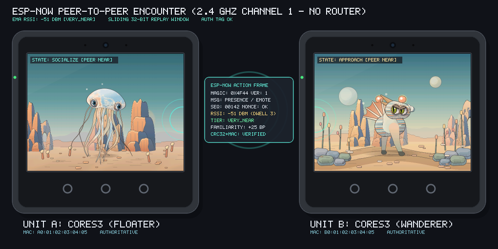
</p>

---

## Installation & Flashing

Prebuilt M5Launcher, OTA, and full factory `.bin` images are available in [`sdcard/`](sdcard/) and on the [GitHub Releases](https://github.com/ericliberda7/oddlings/releases) page:

```bash
# Flash full factory image (includes bootloader + partition table at 0x0000)
esptool.py --chip esp32s3 write_flash 0x0000 sdcard/Oddlings_Full_Merged.bin

# Or flash app partition only (at 0x10000)
esptool.py --chip esp32s3 write_flash 0x10000 sdcard/Oddlings.bin
```
